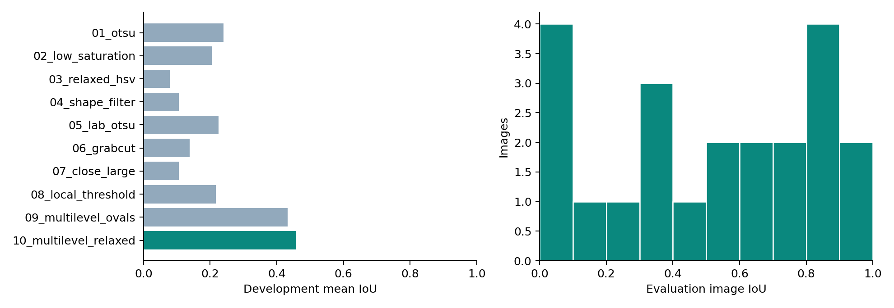
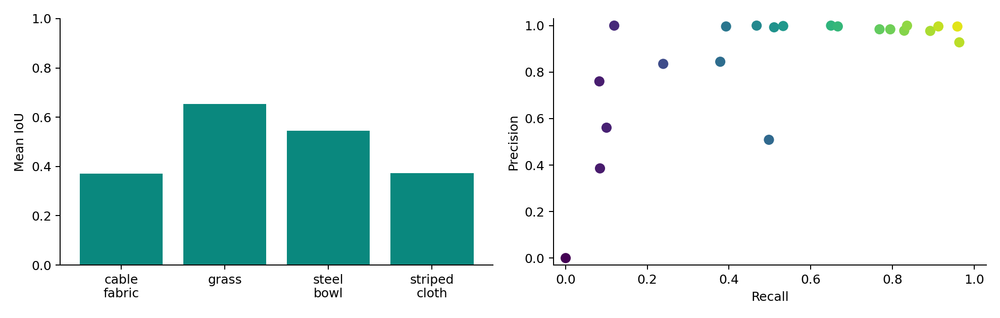
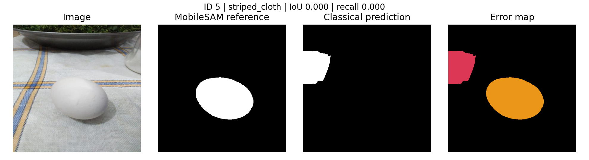
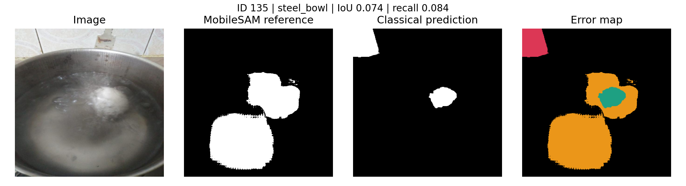
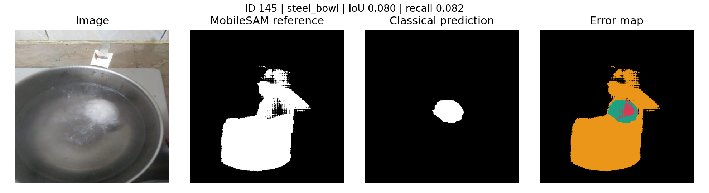
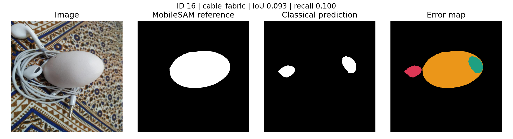
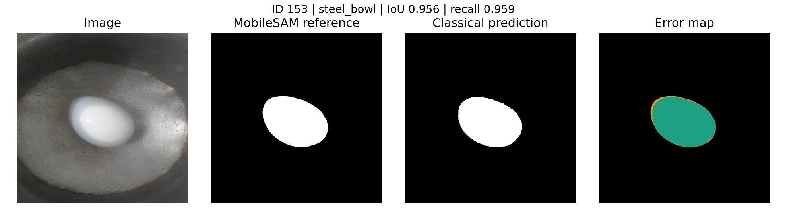
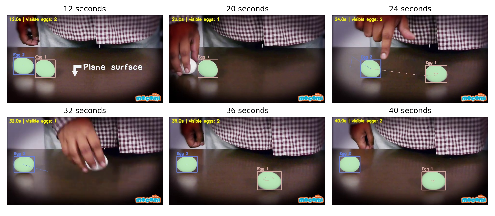

# Egg segmentation and individual tracking

Nosh Robotics CV Intern Assignment | 28 October 2026

This submission generates pretrained reference masks for all 110 images, develops an image-only classical segmenter, compares ten measured development trials, and processes all 1,440 frames of the supplied 60-second video.

## Measured result

| Metric | Development (88) | Evaluation (22) |

| --- | --- | --- |

| Mean IoU | 0.456 | 0.515 |

| Mean Dice | 0.549 | 0.617 |

| Mean precision | 0.748 | 0.851 |

| Mean recall | 0.475 | 0.531 |

| Boundary F1 (3 px) | 0.273 | 0.307 |

| Micro IoU | 0.463 | 0.452 |

Evaluation mean IoU is 0.515; the scene-cluster bootstrap interval is 0.372-0.606. Only four evaluation scene groups contribute, so uncertainty is substantial. Recall trails precision: missing egg regions are the dominant error. This method does not closely match MobileSAM on all backgrounds.

The tracking output contains 1440 frames at 24 fps and emits 2 track IDs. It is silent and retains the full source duration. ID count is a diagnostic, not a tracking-accuracy score.

Public repository: <link href="https://github.com/MuditTandon20/nosh-robotics-egg-segmentation">https://github.com/MuditTandon20/nosh-robotics-egg-segmentation</link>

Tracking video on Google Drive: <link href="https://drive.google.com/file/d/1XDrUo4D_BzqZPXqDqBrPhjaMHzaO1i-r/view?usp=drivesdk">Open tracking video</link>. Public access verification: verified: anyone with the link can view. A downloadable copy is also included in the public repository at outputs/egg_tracking.mp4.

## Scope and honest limits

Reference masks are pretrained-model pseudo-ground truth, not independent human pixel annotations. Difficult submerged eggs remain uncertain. An early exploratory run produced evaluation metrics before reference QC and the final candidate method were finished; the final split is scene-disjoint, but it must not be described as a pristine blind test. No parameters were chosen by maximizing the final evaluation result.

## 1. Data, leakage reduction and reference masks

The assignment links the egg-vzhtr version-1 Roboflow dataset and an alternative ZIP. The ZIP contains 110 JPEGs distributed across train, test and valid folders, including two images in an Unlabeled folder. All images are included. Original folder labels do not provide pixel masks. The bundled dataset README declares CC BY 4.0 and 640 x 640 stretched preprocessing; there are no exported augmentations.

A visual scene inventory assigns the 110 images to 21 conservative groups. Related views of hands, the same counter, bowl, fabric, keyboard and other setups stay together. A seed-2026 subset-sum allocation selects whole groups totaling exactly 22 images; 88 remain for development. Evaluation groups are cable_fabric (3), grass (5), striped_cloth (4), and steel_bowl (10). Source images and independent prompts are recorded in data/manifest.json.

Exact cross-split duplicates: 0. Minimum cross-split 63-bit perceptual-hash Hamming distance: 18. The nearest pairs are recorded in outputs/leakage_audit.json. Scene grouping and hashes reduce leakage; camera/session metadata is unavailable and scene independence cannot be proven.

Task 1 uses the official pretrained MobileSAM vit_t checkpoint on CPU, without fine-tuning. MobileSAM preserves SAM's promptable mask-decoder interface with a smaller encoder. Foreground points are specified independently by visual inspection. Other egg centers become negative points to keep instance masks separate. Selected ambiguous images receive independent coarse localization boxes. This is a prompted pretrained pipeline, not autonomous semantic egg detection.

For each prompt, inference returns three masks and their model quality scores; the highest-scoring mask is retained. Instance labels are saved as uint16 PNGs, with 0 as background. Their union is the semantic reference used in evaluation. Raw quality scores can exceed 1 and must not be interpreted as calibrated probabilities. Model SHA-256, device, timing and scores are in outputs/reference_audit.json.

A thumbnail audit was followed by full-resolution review of suspicious examples. Points were corrected where they landed on bars, shadows or pot rims; coarse boxes were added to reduce background leakage. These corrections use image appearance, not classical predictions. No model masks were replaced with traced manual pixel masks. Images 124, 135 and 145 show eggs through boiling water; bubbles and weak boundaries make their model references especially uncertain. Their scores measure agreement with these references rather than objective segmentation accuracy.

Reproducibility: data/manifest.json fixes prompts, boxes, groups and image SHA-256 hashes. Re-running src.prepare reproduces the same manifest and split. Checkpoint provenance and references appear at the end of this report.

## 2. Classical method and experiment design

All classical runs use image pixels alone. There is no access to prompts, source IDs, scene labels or reference masks during inference. Images are resized to 384 x 384 for consistent morphology. The first eight trials test grayscale Otsu, HSV brightness/saturation limits, shape filtering, Lab thresholding, GrabCut refinement, larger closing, and local adaptive thresholding.

The development failures of fixed thresholds motivated a multilevel method. It blurs grayscale with a 7 x 7 kernel, searches thresholds 55 through 235 in steps of 10, closes with a 5 x 5 kernel, and examines closed contours. Candidates must occupy 0.4%-45% of the working image, have at least five contour points, fitted minor diameter at least 12 pixels, axis ratio at most 2.3, center inside the inner 92% of the frame, ellipse IoU at least 0.80, and mean HSV saturation at most 110.

Candidate score = 0.40 x ellipse IoU + 0.15 x solidity + 0.15 x circularity + 0.15 x (1 - mean saturation / 255) + 0.15 x clipped inside-versus-ring contrast / 80. The ring is generated by a 13 x 13 dilation. Accept scores at least max(0.72, best score - 0.09). Suppress candidates overlapping an accepted region by more than 25% of the smaller area; retain at most four. The selected trial uses circularity >= 0.50 and solidity >= 0.85. The union is resized back with nearest-neighbor interpolation.

Trials 01-08 were a predefined ablation batch. Trials 09-10 were added after the development failures above. The winning configuration is selected solely by development macro IoU; there is no training step. The full trial records include exact parameters, motivation, all development metrics and keep/discard reasons in outputs/experiments.json. Each trial below is a real completed run.

| Trial | Dev IoU | Dev Dice | Decision |

| --- | --- | --- | --- |

| 01_otsu | 0.240 | 0.275 | discarded |

| 02_low_saturation | 0.205 | 0.233 | discarded |

| 03_relaxed_hsv | 0.079 | 0.087 | discarded |

| 04_shape_filter | 0.106 | 0.116 | discarded |

| 05_lab_otsu | 0.225 | 0.258 | discarded |

| 06_grabcut | 0.139 | 0.156 | discarded |

| 07_close_large | 0.105 | 0.119 | discarded |

| 08_local_threshold | 0.217 | 0.230 | discarded |

| 09_multilevel_ovals | 0.433 | 0.515 | discarded |

| 10_multilevel_relaxed | 0.456 | 0.549 | kept |

## Experiment log: parameters and decisions

01_otsu — Bright egg against darker background; establish a simple baseline.

Parameters: method=otsu, saturation=85, value=110, min_area=0.003, max_area=0.4, circularity=0.45, solidity=0.82, close=5, grabcut=0. Development IoU 0.240, Dice 0.275. Discarded: Lower development mean IoU than selected configuration.

02_low_saturation — Reject colored backgrounds using low saturation and high brightness.

Parameters: method=hsv, saturation=70, value=130, min_area=0.003, max_area=0.4, circularity=0.45, solidity=0.82, close=5, grabcut=0. Development IoU 0.205, Dice 0.233. Discarded: Lower development mean IoU than selected configuration.

03_relaxed_hsv — Recover shadowed egg regions by relaxing color thresholds.

Parameters: method=hsv, saturation=100, value=95, min_area=0.003, max_area=0.4, circularity=0.45, solidity=0.82, close=5, grabcut=0. Development IoU 0.079, Dice 0.087. Discarded: Lower development mean IoU than selected configuration.

04_shape_filter — Reject irregular background fragments with stronger shape constraints.

Parameters: method=hsv, saturation=85, value=110, min_area=0.003, max_area=0.4, circularity=0.6, solidity=0.88, close=5, grabcut=0. Development IoU 0.106, Dice 0.116. Discarded: Lower development mean IoU than selected configuration.

05_lab_otsu — Use illumination thresholding in Lab and suppress chromatic pixels.

Parameters: method=lab, saturation=95, value=95, min_area=0.003, max_area=0.4, circularity=0.45, solidity=0.82, close=5, grabcut=0. Development IoU 0.225, Dice 0.258. Discarded: Lower development mean IoU than selected configuration.

06_grabcut — Refine candidate boundaries with foreground/background color models.

Parameters: method=hsv, saturation=85, value=110, min_area=0.003, max_area=0.4, circularity=0.45, solidity=0.82, close=5, grabcut=3. Development IoU 0.139, Dice 0.156. Discarded: Lower development mean IoU than selected configuration.

07_close_large — Bridge egg highlights and small cracks; risk merging background.

Parameters: method=hsv, saturation=85, value=110, min_area=0.003, max_area=0.4, circularity=0.45, solidity=0.82, close=11, grabcut=0. Development IoU 0.105, Dice 0.119. Discarded: Lower development mean IoU than selected configuration.

08_local_threshold — Try local contrast to handle uneven illumination; may amplify textured backgrounds.

Parameters: method=local, saturation=85, value=100, min_area=0.003, max_area=0.4, circularity=0.45, solidity=0.82, close=5, grabcut=0. Development IoU 0.217, Dice 0.230. Discarded: Lower development mean IoU than selected configuration.

09_multilevel_ovals — Development failures show that one threshold merges eggs with pale backgrounds. Search multiple thresholds and rank oval candidates.

Parameters: method=multilevel, saturation=85, value=110, min_area=0.003, max_area=0.4, circularity=0.65, solidity=0.9, close=5, grabcut=0. Development IoU 0.433, Dice 0.515. Discarded: Lower development mean IoU than selected configuration.

10_multilevel_relaxed — Recover less regular egg contours; test whether increased recall outweighs background false positives.

Parameters: method=multilevel, saturation=85, value=110, min_area=0.003, max_area=0.4, circularity=0.5, solidity=0.85, close=5, grabcut=0. Development IoU 0.456, Dice 0.549. Kept: Highest development mean IoU.

For non-multilevel methods, minimum/maximum area are fractions of the 384 x 384 frame, close is kernel width, value/saturation use OpenCV 0-255 channels, and grabcut counts iterations. The multilevel branches use the explicitly stated area, blur and kernel settings above; Config fields for HSV thresholds, close and GrabCut do not affect those branches.

## 3. Quantitative evaluation and interpretation

For foreground pixels, TP is intersection, FP is prediction outside the reference, and FN is reference missed by prediction. IoU = TP/(TP+FP+FN); Dice = 2TP/(2TP+FP+FN); precision = TP/(TP+FP); recall = TP/(TP+FN). Reported primary scores are image means. Micro IoU pools pixels across images and therefore weights larger reference regions more heavily. Empty reference and prediction score 1; an empty prediction against a nonempty reference scores 0.

Boundary F1 compares boundaries obtained by binary erosion, with matches within three pixels at original 640 x 640 resolution. Bootstrap confidence bounds resample whole scene groups with replacement, 2,000 times using seed 2026; they are conditional on this small split and model-generated references. Per-scene single-group confidence bounds are degenerate and should not be interpreted as uncertainty estimates.

The broad gap between precision and recall indicates conservative selection: pale backgrounds merge with shells, while shadows and textures produce fragmented or non-oval regions that fail the shape filters. Lower boundary F1 shows that even detected eggs often have inaccurate silhouettes. Evaluation IoU exceeds development IoU here, which reflects scene composition rather than evidence of better generalization.

Classical development inference averages 47.7 ms/image and evaluation inference 59.6 ms/image on this run, excluding image loading and metric computation. Timing is a single-run measurement affected by concurrent work; no throughput benchmark is claimed.

## Qualitative failures and a successful example

Examples are selected mechanically: the four lowest-IoU evaluation images and the highest-IoU image. Error colors: teal = intersection, amber = missed reference foreground, red = extra prediction. These figures expose errors rather than selecting only successful samples.

Most of the reference egg is missed. The contour search fails to find a sufficiently closed oval at any threshold.

Most of the reference egg is missed. The contour search fails to find a sufficiently closed oval at any threshold.

## Further qualitative examples

Most of the reference egg is missed. The contour search fails to find a sufficiently closed oval at any threshold.

Most of the reference egg is missed. The contour search fails to find a sufficiently closed oval at any threshold.

Successful example: a neutral shell is separated from its background at one of the searched thresholds, producing a closed oval.

## 4. Video tracking

The supplied YouTube clip is 60 seconds, 640 x 360 at 24 fps. Every decoded frame is processed and written. Intro/outro frames are retained, and no detections are fabricated during occlusion. Detection adapts the classical component pipeline to the tabletop domain: HSV saturation < 75, value > 170, 3 x 3 closing, area 0.6%-3.5%, circularity >= 0.55 and solidity >= 0.82. Masks outside x=2%-94% and y=42%-90% are suppressed to exclude the shirt, title and logo. This video-specific tuning does not change the evaluated still-image method.

Contours supply centroids to a constant-velocity Kalman filter. Hungarian assignment minimizes centroid distance under a 256-pixel gate. Velocity is damped and zeroed after three missed frames to limit drift while a hand covers an egg. Tracks survive up to 192 missed frames (8 seconds), chosen after visual inspection of the clip's long hand occlusions. IDs are associated with detections only; missed tracks are not drawn as visible eggs. Full detections and IDs are exported to outputs/tracks.csv.

Run summary: 1440 frames, 2 total IDs, detection-count histogram {'0': 677, '2': 538, '1': 225}. The threshold/shape detector was refined to remove small white text/reflection fragments; tracking retention was increased after inspecting identity fragmentation under hands. These are video-specific experiments, not held-out video validation.

Limitations: a long retention window can associate the wrong egg after a full occlusion, and centroid assignment does not establish identity through crossing, cuts or exits. Two IDs alone do not prove zero switches. There are no manually annotated trajectories or masks for this video, so MOTA, IDF1 and HOTA are not reported. The output is a visual demonstration with track logs, not a quantitatively validated tracker.

## Improvements, reproducibility and AI disclosure

Highest-priority improvements: (1) manually audit and correct an independent subset of model references, especially submerged eggs; (2) collect more genuinely independent scenes and reserve a new untouched evaluation set; (3) use edge continuity or marker-controlled watershed to recover shells merged into pale backgrounds and separate touching eggs; (4) add texture and local background models to reject smooth background ovals; (5) annotate a short video interval and measure detection recall, fragmentation and identity switches before tuning re-identification.

The code is divided into preparation, pretrained inference, classical segmentation, evaluation, tracking and report generation modules. README.md gives exact setup and commands. Artifacts include all 110 reference masks, all 110 final prediction masks, per-image CSV metrics, full experiment JSON, selected configuration, scene/hash audit, plots, track CSV and MP4. Raw data and weights are fetched separately and excluded from Git.

Validation performed: known-overlap metric arithmetic and empty-mask conventions; exactly 88/22 image counts and scene separation; image-hash uniqueness and reference-mask completeness; recovery of two synthetic eggs; and identity stability under reordered detections and a short synthetic occlusion. A decoded-frame validation also checks the output video duration and frame count. These checks do not replace manual scene or reference annotation.

AI disclosure: OpenAI Codex assisted with implementing the Python pipeline, inspecting image thumbnails, specifying/correcting point and box prompts, proposing classical trials, running experiments, diagnosing failures, preparing visualizations and writing this report. The numerical results are generated from executed code, not invented. The candidate should study and reproduce the implementation and be ready to explain and modify it in the interview; this report does not assert independent candidate authorship or understanding.

Experimental integrity note: an early exploratory run generated evaluation scores before final reference review. Later methods were motivated by development failures, and final ranking uses development results only. Because evaluation outputs had already been exposed during development, the final scene-disjoint evaluation is exploratory rather than a fully blind confirmation. This is a limitation to resolve with new data.

## Sources and attribution

Assignment dataset / Roboflow, CC BY 4.0: <link href="https://universe.roboflow.com/fire-bf7qe/egg-vzhtr/dataset/1">https://universe.roboflow.com/fire-bf7qe/egg-vzhtr/dataset/1</link>

Alternative dataset archive: <link href="https://drive.google.com/file/d/1a58rACcCFnaj0ZiDoNyGbDWXunRyWziv/view">https://drive.google.com/file/d/1a58rACcCFnaj0ZiDoNyGbDWXunRyWziv/view</link>

SAM: official implementation and promptable segmentation: <link href="https://github.com/facebookresearch/segment-anything">https://github.com/facebookresearch/segment-anything</link>

MobileSAM: official code and checkpoint, Apache 2.0: <link href="https://github.com/ChaoningZhang/MobileSAM">https://github.com/ChaoningZhang/MobileSAM</link>

Source video: Mocomi, Raw and Boiled Egg Spinning: <link href="https://www.youtube.com/watch?v=Y4JyV94y2_A">https://www.youtube.com/watch?v=Y4JyV94y2_A</link>
